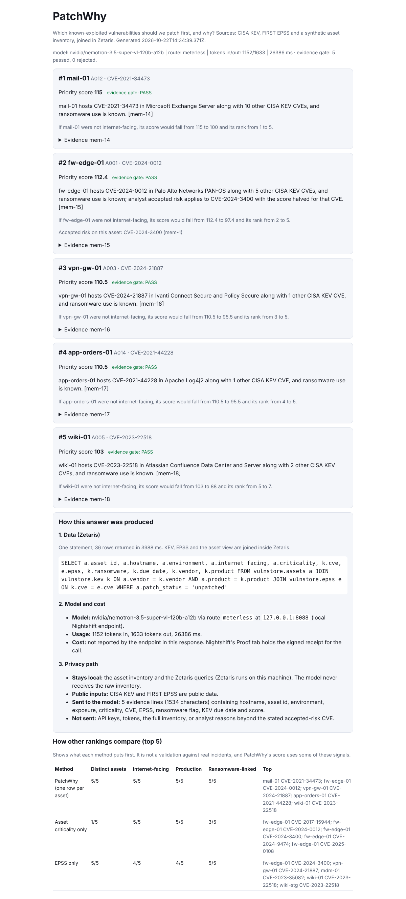
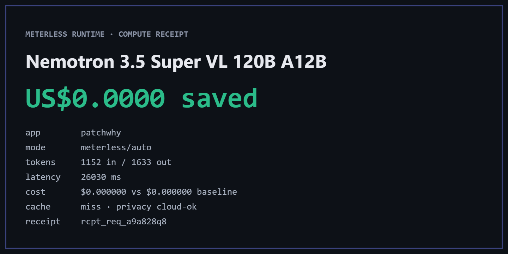

# PatchWhy

**Which known-exploited vulnerabilities should we patch first, and why?**

PatchWhy is an agent for small security teams. It joins three data sources in Zetaris, ranks the unpatched assets with fixed, auditable weights, remembers analyst decisions in Meterless H-MEM, and has NVIDIA Nemotron explain each ranking. Every explanation must pass an evidence gate before it is shown. Entry for **Track 02: The Agent That Can Explain Why**.

## The problem
Security teams cannot patch everything. Ranking by a generic severity score sends them after the wrong things, and a ranking nobody can explain is hard to defend. PatchWhy puts real exploitation evidence together with what the company actually runs, and shows its reasoning.

## What it does
1. **Data (Zetaris).** One SQL statement joins three sources, queried in place:
   - CISA Known Exploited Vulnerabilities (public JSON)
   - FIRST EPSS exploitation probabilities (public API)
   - an asset inventory (**synthetic**: a made-up company, see `data/assets.csv`)
2. **Score (plain code).** Fixed weights: EPSS, asset criticality, internet exposure, ransomware use, environment, and a small bonus for other known-exploited CVEs on the same asset. The model never chooses the ranking.
3. **Remember (Meterless H-MEM).** Each top finding is stored with its source. Analyst decisions ("accepted risk on this CVE") are stored in H-MEM and change the next ranking. Every record has an append-only ledger you can audit.
4. **Explain (NVIDIA Nemotron via Meterless Nightshift).** The model writes one line per finding from the evidence only.
5. **Evidence gate.** A model line is shown only if it cites a memory id from this run and every number in it appears in the cited evidence. Otherwise a template sentence is used and the rejection is reported.
6. **Counterfactuals.** "If this host were not internet-facing, its score would fall from X to Y and its rank from A to B." Computed by re-scoring, not by the model.
7. **Guardrails.** At most 2 model calls per request. If the model is unavailable, or the gate rejects a line, the run prints `NEEDS HUMAN REVIEW`, shows template sentences instead, and points to the `audit` command. The ranking itself never depends on the model.
8. **Report.** `out/report.html` shows the findings, evidence, gate results, a comparison with simpler rankings, and a "How this answer was produced" section: the exact SQL, rows and time, the model, route and endpoint, token usage, and what is and is not sent to the model.



## How to run
Requirements: Docker (Zetaris local platform), Node 22+, a Nightshift runtime token and NVIDIA key (see the hackathon Power guide).

```bash
# 1. Zetaris: start the platform, then run sql/zetaris.sql one statement at a time in the SQL Workspace
# 2. Agent
npm install
npm run setup                       # vendors the H-MEM reference into vendor/ (gitignored)
cp .env.example .env                # fill in ZETARIS_* and MODEL_* values; never commit .env
npx tsx patchwhy.ts run             # rank, remember, explain, gate, write out/report.html
npx tsx patchwhy.ts run --no-model  # same without the model call
npx tsx patchwhy.ts override A001 CVE-2024-3400 "accepted risk until the Friday window"
npx tsx patchwhy.ts audit mem-1     # ledger history of one memory
npx tsx patchwhy.ts compare         # three rankings side by side
npm test                            # unit tests + H-MEM integration test
```

Environment variables: `ZETARIS_REST_URL`, `ZETARIS_ORG_ID`, `ZETARIS_API_KEY`, `MODEL_BASE_URL`, `MODEL_API_KEY`, `NEMOTRON_MODEL`, optional `MODEL_ROUTE=meterless`.

Fill in **one** model route only (Nightshift: `MODEL_BASE_URL=http://127.0.0.1:8088/v1`, `NEMOTRON_MODEL=meterless/auto`). If a key appears twice in `.env` the first value wins, and PatchWhy prints a warning. The report states which endpoint was actually used and labels a non-local route as "direct".



*Signed Nightshift receipt for one real PatchWhy call (client `patchwhy`).*

## Demo Video
Demo video (3 min 23 s): https://youtu.be/gNwycIu_thg

## Sponsor technology
- **Zetaris:** three REST/inline sources joined by one SQL statement over the REST API; no data copied.
- **Meterless H-MEM:** stores evidence and analyst decisions with sources; a remembered decision changes the ranking (`test/hmem_integration.test.ts` proves this against the real engine) and each record has an audit ledger.
- **Meterless Nightshift + NVIDIA Nemotron:** the explanation model runs through the local Nightshift endpoint (`127.0.0.1:8088`, model `meterless/auto`); in my runs Nightshift served an NVIDIA Nemotron model (the report records the model name it returns). Nightshift issues a signed receipt per call (Proof tab). The HTTP response carries no cost figure, so the report says so rather than guessing; the signed receipt does: Nightshift's receipts list my runs under client `patchwhy`, served by Nemotron (3.5 Super VL 120B A12B in the receipt shown; other runs were served by Nemotron 3 Ultra 550B, as each report records), signed by `meterlessd` (Ed25519), with a cost of $0.0000 per call on my trial credits.

## Honest limits
- The asset inventory is synthetic. The scoring weights are my own and are not validated against real incident data.
- `compare` shows what different rankings put first. It is not a validation, and PatchWhy's score uses some of the signals it is compared on.
- The EPSS table holds the top 1,000 scores only; KEV CVEs outside that set are not scored.
- The evidence gate checks citations and numbers, not whether a sentence is wise.

## Pre-existing code and AI assistance
- **Pre-existing (Meterless agentathon-starter, Apache-2.0):** `notebook.ts`, `src/engine.ts`, `src/llm.ts`, `seed/`, `images/`, the vendored H-MEM reference (`vendor/`, installed by `npm run setup`). The original README is `TEMPLATE_README.md`.
- **New work for this hackathon:** `patchwhy.ts`, `src/patchwhy_core.ts`, `src/overrides.ts`, `src/report.ts`, `test/`, `data/`, `sql/`, `docs/`.
- Built solo by Bharadwaj Rachuri. AI coding tool used: Claude. I reviewed, ran and tested all of it.

## Layout
`patchwhy.ts` CLI | `src/patchwhy_core.ts` scoring, counterfactuals, evidence gate | `src/overrides.ts` decisions read back from H-MEM | `src/report.ts` HTML report | `sql/zetaris.sql` Zetaris setup | `data/assets.csv` synthetic inventory | `docs/agent-loop-spec.md` design notes
